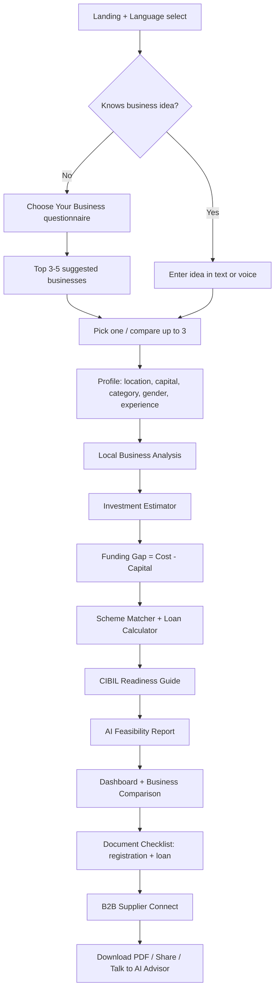
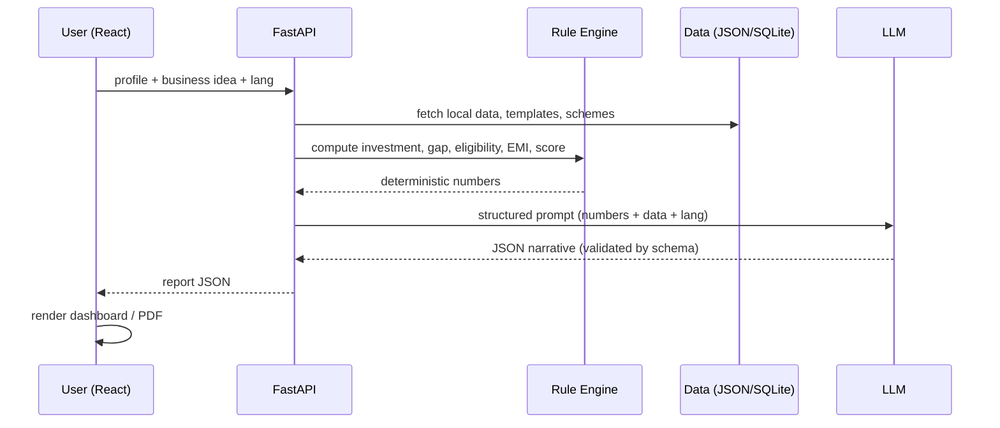

# 01 · Workflow

> Working name: **GramUdyam AI** (rename freely).
> GenAI-powered business feasibility + finance planner for rural entrepreneurs.

---

## 1. Problem → Solution in one line

Rural entrepreneurs lack a trustworthy way to answer: *"Which business should I start here, how much will it cost, can I afford it, which government loan fits me, and what do I need to apply?"*
GramUdyam AI answers all five in one guided journey, in the user's own language.

## 2. Primary persona (use this in the demo)

**Sunita, 34, village near Nashik.** Has ₹50,000 savings, no CIBIL history, speaks Marathi, wants to start a dairy unit. She doesn't know market demand, scheme names, or documents needed.

Secondary personas: a youth with a smartphone shop idea (urban-fringe town), an SHG member exploring tailoring, a farmer exploring agri-processing.

---

## 3. End-to-end user journey



AI Business Advisor (chat) is available **at every step** as a floating assistant that knows the user's current context.

---

## 4. Module-by-module flow

### 4.1 Language & onboarding
1. User picks language (English / हिन्दी / मराठी to start).
2. Language is stored in app state + sent to backend on every AI call (`lang` param).
3. Short intro: what we'll do, ~5 minutes, no login required for the demo.

### 4.2 Choose Your Business (discovery)
- **Inputs:** interest areas (agri, food, retail, services, manufacturing, craft), budget range, available time (full/part), skills, land/space available, village vs. town, electricity/water access, gender/category (for scheme eligibility later).
- **Logic:** rule-based filter over a `business_catalog` (hard constraints: budget, space, skills) → LLM ranks and explains top 5 ("why this suits you").
- **Output:** cards with business name, typical investment range, expected monthly income range, difficulty, a "Select" and "Compare" button.

### 4.3 Business idea input
- Free text (or voice) → LLM **normalises** it into `{business_type, scale, product_list, target_customer}`.
- Ambiguities are shown back to the user to confirm ("Dairy: 2 cows or 10?").

### 4.4 Local Business Analysis
- **Inputs:** district/village (via dropdown + pin/PIN code), business type.
- **Data used:** curated local dataset (population, nearby towns/markets, competitor counts, avg. prices, seasonal demand, supply availability) + LLM reasoning.
- **Output:** demand level, potential customer segments, competitor density, opportunities, risks (seasonality, price volatility, logistics), a **market score /100**.

### 4.5 Investment estimator
- Template per business: line items (equipment, raw material, licences, working capital, rent/deposit, marketing, contingency 10%).
- LLM adjusts quantity/prices using scale + local price hints; backend **validates arithmetic** (never trust LLM sums).
- Output: `total_investment`, `fixed_cost`, `working_capital`, itemised table.

### 4.6 Funding gap
```
funding_gap = max(0, total_investment − user_capital)
capital_ratio = user_capital / total_investment
```
If `funding_gap == 0` → skip loans, show "self-funded" path; else continue.

### 4.7 Smart Scheme Matcher
1. Deterministic rule engine filters `schemes.json` by: loan size, sector, gender, social category, location type (rural/urban), age, business stage (new), collateral availability.
2. Each scheme gets `eligible: true/false/maybe` + reasons.
3. LLM writes the plain-language explanation (benefits, subsidy, process) **from the JSON only** (no outside facts).
4. Ranked by: eligibility → subsidy value → interest rate → collateral need.

### 4.8 Loan & repayment calculator
- Inputs: loan amount (default = funding gap), interest rate (from scheme), tenure, moratorium.
- Output: EMI, total interest, amortisation table, **DSCR** and a "can I afford this EMI?" check against projected monthly profit.
- Slider UI so the user can play with tenure/amount.

### 4.9 CIBIL Readiness Guide
Honest framing: we **don't fetch or fix** a score; we guide.
1. User answers: existing loans? missed EMIs? credit card use? first-time borrower? income proof?
2. Rule-based readiness bucket: *Strong / Fair / Thin-file / Needs repair*.
3. Output: what lenders look at, 30/60/90-day improvement actions, and **alternative routes** for thin-file users (Mudra Shishu, SHG-bank linkage, CGTMSE-backed loans, co-applicant).

### 4.10 AI-Generated Feasibility Report
Aggregates everything into one structured JSON → rendered page + downloadable PDF.
Sections: summary verdict, market analysis, investment, funding gap, schemes, repayment plan, break-even, risks & mitigation, recommendations, next steps.
Verdict: **Highly Feasible / Feasible with conditions / Risky / Not recommended**, driven by the score in §5.

### 4.11 Dashboard & Business Comparison
- Dashboard charts: investment breakdown (donut), capital vs. gap (bar), 12-month profit projection (line), loan balance over time (area), risk radar, feasibility gauge.
- Comparison: up to 3 businesses side-by-side (investment, gap, EMI, break-even months, score, top risk) with a "best fit" badge and short LLM rationale.

### 4.12 Document checklist
Two lists generated from a **fixed base list** + LLM tailoring:
- **Registration:** Udyam registration, shop & establishment/Gram Panchayat licence, GST (if applicable), FSSAI (food), trade licences, etc.
- **Loan:** Aadhaar, PAN, address proof, photos, bank statements, project report, quotations, caste/category certificate (if claiming), land/rent proof, etc.
Each item: why it's needed, where to get it, approx. time/cost, status checkbox (saved locally).

### 4.13 B2B connect
- Curated supplier directory by `category × district` (raw material, equipment, packaging, wholesale).
- Filter by distance, price band, MOQ; "Request quote" button (stores lead / opens WhatsApp/phone deep-link).
- Also a lightweight "list your business as a supplier" form for the pitch.

### 4.14 AI Business Advisor (chat)
- Context-aware chat with the user's profile + latest report injected into the system prompt.
- Suggested prompts: "Why was my score 62?", "What if I reduce investment by 20%?", "Explain Mudra in Marathi".
- Voice in/out (Web Speech API) for low-literacy users.

---

## 5. Feasibility scoring model (transparent & explainable)

| Factor | Weight | Source |
|---|---|---|
| Market demand & competition | 25% | Local analysis |
| Capital adequacy (capital ÷ investment) | 20% | Calculator |
| Repayment strength (DSCR) | 25% | Calculator |
| Break-even speed | 15% | Projection |
| Risk exposure | 15% | Local analysis + LLM |

```
score = Σ(weight_i × factor_score_i)       # each factor 0–100
≥ 75  Highly feasible
55–74 Feasible with conditions
40–54 Risky
< 40  Not recommended
```
Keep the formula visible in the report so judges see it isn't a black box.

**Projection basics**
```
monthly_net_profit = revenue − variable_cost − fixed_opex
break_even_months  = total_investment / monthly_net_profit
DSCR = (annual_net_profit + depreciation + interest) / (annual_principal + annual_interest)   # ≥ 1.25 is healthy
```

---

## 6. Data flow



**Golden rule:** *numbers come from code, words come from the LLM.* The LLM never invents schemes, interest rates, or totals.

---

## 7. Error & edge cases to handle
- LLM returns invalid JSON → retry once with repair prompt → fall back to template text.
- Location not in dataset → fall back to district-level averages + show "approximate" badge.
- Funding gap = 0 → skip scheme step gracefully.
- No scheme eligible → suggest alternatives (SHG, co-applicant, reduce scale, NBFC/microfinance) instead of an empty state.
- Low connectivity → cache last report in `localStorage`, allow PDF download.

## 8. Demo script (3 minutes)
1. (20s) Persona + problem.
2. (40s) Choose-your-business → pick dairy in Nashik district, Marathi UI.
3. (40s) Local analysis + investment → gap ₹X.
4. (40s) Scheme match + EMI slider + CIBIL readiness (thin-file path).
5. (30s) Feasibility report + dashboard + comparison with a second idea.
6. (10s) Document checklist + supplier list + closing line on impact.

## 9. Build plan (adjust to your hackathon length)

| Phase | Output |
|---|---|
| 0 · Setup (1–2h) | Repo, env, API key, skeleton routes, Tailwind, i18n |
| 1 · Core engine | Business templates, calculator, schemes.json, rule engine |
| 2 · AI layer | Prompts + JSON schemas for report, advisor, discovery |
| 3 · UI flow | Questionnaire → profile → report → dashboard |
| 4 · Extras | Comparison, documents, CIBIL guide, B2B directory |
| 5 · Polish | Multilingual, PDF export, voice, demo data, pitch deck |

**MVP cut line (if time runs out):** Discovery → Idea input → Report (with investment, gap, schemes, EMI) → Dashboard. Everything else is a bonus.
